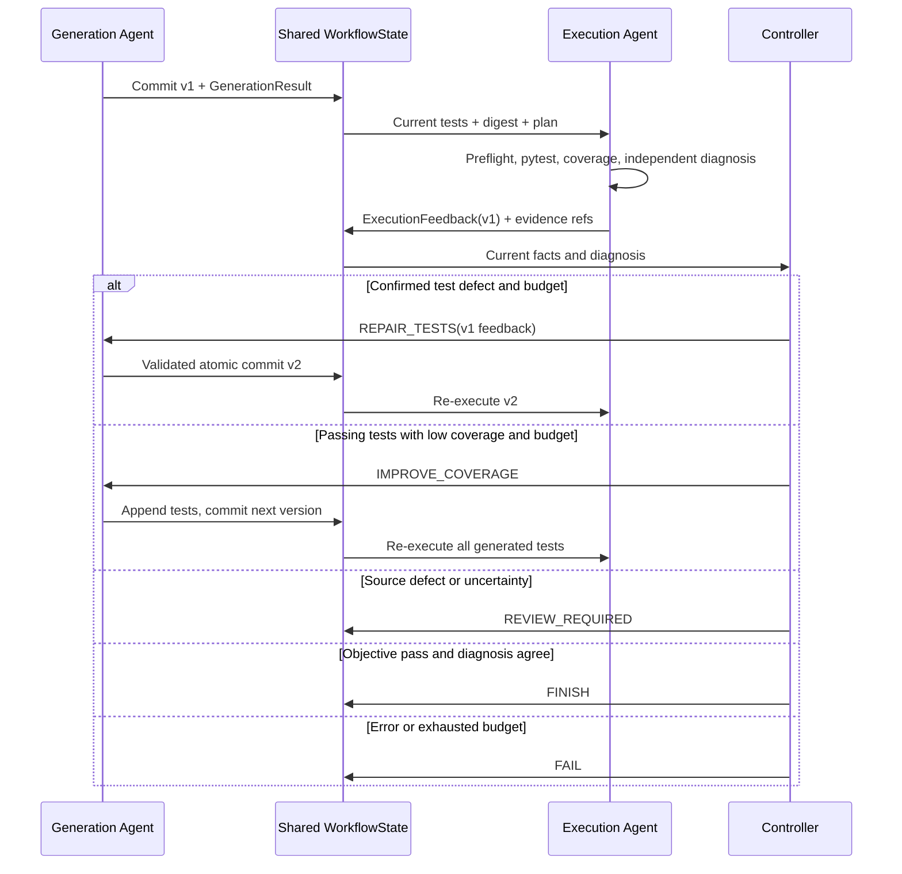

# TestPilot-WF Design

## 1. H1 与 H2 的边界

H1 是单 Agent + 确定性 Controller + 多工具节点。H2 保留 H1 包，使用两个独立业务 Agent，每个角色有自己的目标、prompt、模型实例、结构化输入输出与调用记录。Controller 不是第三个 Agent。

Generation 使用 H1 AgentNodes 的 analyze/plan/generate/repair/improve **内部工具方法**，没有 Runner；不会运行 H1 graph/controller/execute。Execution 不拥有测试写权限，负责独立诊断。H1 DeepSeekClient 仅添加两个可覆盖的类属性 `system_prompt`、`task_prompts`，默认保持 H1 行为。精确 Patch、保留用例、去重、AST、上下文、Runner 等继续复用。

来源与源码审计见 [H1-Audit.md](docs/H1-Audit.md)。H1 原仓库未修改，Git 历史、密钥、旧证据均未复制。

## 2. 角色与工具权限

| 角色 | 独立任务 | 工具 | 输出 |
|---|---|---|---|
| Generation | INITIAL_GENERATION / REPAIR_TESTS / IMPROVE_COVERAGE | Scanner、AST、ContextSelector、精确 Patch、候选校验 | GenerationResult、测试版本与内容摘要 |
| Execution | PREFLIGHT / EXECUTE / DIAGNOSE | preflight、TestRunner、CoverageAnalyzer、诊断模型 | 工具事实与 ExecutionFeedback |
| Controller | 事实验收、预算、路由 | 无 LLM | FINISH / FAIL / REVIEW_REQUIRED 或回到 Generation |

Generation prompt 强调有意义断言、源代码契约和反馈；Execution prompt 强调证据引用、失败归因、疑似源码缺陷和不确定性。通过路径也调用 `ExecutionLLM.diagnose`。两个角色可使用同一模型服务，但不共享对话或客户端实例。模型本身只返回数据，不具备任意工具执行能力。

## 3. 消息契约与版本

`AgentMessage` 的 sender/receiver/type 为固定方向；`payload` 为 GenerationResult 或 ExecutionFeedback。Pydantic 禁止多余字段，校验 payload 类型、方向和版本；消息有唯一 ID、连续逻辑 sequence、证据引用。

- GenerationResult：模式、版本、计划、tests_ref、SHA-256 摘要、摘要说明、告警。
- ExecutionFeedback：版本、execution_ref、coverage_ref、分类、原因、动作、证据引用、review_required、uncertainty、diagnosis_status。
- 分类：PASS、REPAIR_TEST、IMPROVE_COVERAGE、SUSPECTED_SOURCE_BUG、ENVIRONMENT_ERROR、REVIEW_REQUIRED、DIAGNOSIS_ERROR。

模型只返回 Diagnosis；版本和文件引用由可信代码绑定，不能由模型伪造版本。引用必须来自当轮提供的白名单。pytest 原始事实先落盘，再调用诊断模型。

版本只在**完整候选通过验证、内容确实变化并提交**后递增。失败候选保存在 rejected/repairs，旧测试保持不变。Execution 校验最新消息、版本、内容摘要；Generation 拒绝旧反馈；Controller 再次检查版本和实际测试摘要。

## 4. 共享状态与写入职责

WorkflowState 继承 H1 AgentState 以复用工具接口，增加 mode、test_version、test_digest、generation、feedback、messages、workflow_status、trace、extensions。继承的 H1 status/history/执行历史不是 H2 控制依据，运行中不积累大型执行历史。H2 权威终态为 workflow_status。

Generation 只更新项目分析、计划、测试、版本、生成结果、告警和发送消息；Execution 只更新执行、覆盖率、诊断和发送消息；Controller 更新预算、模式、路由和终态。框架 wrapper 校验返回键的写权限，深拷贝输入避免原地修改共享状态。扩展 Agent 在当前版本只能写 namespaced extensions，由其他节点读取，不能篡改测试或版本。

每版本完整测试和工具事实在磁盘保存；消息使用引用，当前内存仅保留当前执行事实。上下文遵守 H1 字符预算，超限显式失败，不静默截断 JSON。

## 5. LangGraph 与确定性路由



`StateGraph(WorkflowState)` 的顺序链由 WorkflowBuilder 集中构造。业务节点失败直接到 Controller，避免继续执行旧测试。修复/补测默认全局各 2 轮；配置上限各 10，graph recursion limit 随链长度和预算计算。

Controller 不盲信 PASS：returncode、timed_out、failed、errors、实际通过/收集数量、覆盖率及版本都必须满足约束。全部 skip/零通过/未知收集统计不能成功。模型 PASS 但覆盖率不足仍进入补测；模型 PASS 但执行失败进入 REVIEW_REQUIRED。REPAIR 需要真实 traceback 和模型明确归因，疑似源码缺陷停止自动修复。

## 6. 修复和生成防护

保留 H1 单文件精确 old/new Patch、唯一匹配、非重叠修改、原子提交、测试函数及参数行保留机制。H2 额外 preflight 拒绝语法错误、skip/xfail 装饰器、明显进程/网络调用；保守比较已有 assert 和 pytest.raises 的 AST，拒绝修改或移除。

当前策略宁愿停止，也不自动改错误期望值。局部修复允许导入、准备代码等更正；Demo 用导入别名修复拼写错误，完全保留原断言。补测只追加新文件，不将未提交候选伪装成可执行版本。

Generation.invoke 对 H2 preflight 内容错误最多额外尝试一次（两轮候选）。分析和规划不重复；每轮从分析/规划后的同一合法状态深拷贝，拒绝候选不能进入下一轮的 existing_tests。可选结构化 validation_feedback 携带来源、错误类型、候选文件名、可用行号、脱敏错误和保留语义要求；真实 execution_agent_feedback 独立保留，H1 的局部修复验证信息也不会丢失。只有最终完整校验通过才提交一次版本、digest 和一个正式消息，Controller 预算不变。

断言保护与无变化检查优先于可重试 preflight。API/源码分析/上下文/状态错误和 H1 内部校验失败不进入该新循环，保留其原有有限重试或终止方式；特别是 Repair 的语法残缺替换可能先被 H1 retain_tests 拒绝，此时不增加外层重试。INITIAL 和 IMPROVE 新文件的语法错误、三种模式中通过已有保护但违反 H2 导入/标记规则的候选可得到本地反馈。多模块任务重试整个本轮候选生成，最多两轮不等于最多两次模型请求，原 API/格式重试预算未改动。

失败候选分别保存在 rejected/<节点序号>-attempt-01/02.json；第二次成功记录和该轮 H1 repair 证据保存在 generation_attempts/，避免覆盖第一轮。恢复成功的消息摘要、warnings 和既有 Trace evidence_refs 可追踪这些记录。两次失败明确报出候选预算耗尽，不提交版本；所有产物继续由 ArtifactWriter 脱敏。

AST 启发式不能证明语义安全（例如 helper、fixture 或参数值变化也可能改变断言含义），因此不能宣传为形式化验证或安全沙箱。被测代码需可信，未知上传代码应坚持 Docker 隔离，不允许自动 Local 回退。

## 7. 可扩展性

AgentProtocol 约定 `name`、`writes`、`invoke(state) -> dict`。AgentRegistry 提供注册、查询、显式替换。WorkflowBuilder 接受已注册名称组成的受控顺序链，要求 generation 起始、execution 结束，禁止重复和未注册节点。

新增观察节点示例（不用修改 Generation/Execution）：

```python
class AuditAgent:
    name = "audit"
    writes = {"extensions"}

    def invoke(self, state):
        return {"extensions": {**state.extensions, "audit": state.test_version}}


state = run_project(
    "examples/basic",
    demo=True,
    extra_agents=[AuditAgent()],
    chain=("generation", "audit", "execution"),
)
```

测试验证 MockAgent 被实际 LangGraph 调用、接收版本和摘要、输出状态得到保留、原有两个 Agent 无须修改。扩展点是有限顺序链，不是任意图编辑器；新业务需更多共享字段时，应显式扩展 schema/权限，而非任意覆写已有字段。

## 8. 日志、UI 与错误恢复

复用 ArtifactWriter.json 的环境敏感值脱敏、H1 运行目录命名及下载助手。trace 记录 Agent、任务、输入输出消息 ID、版本、预算、状态、错误和 Controller 决策；llm_calls 记录分角色任务、尝试、模型、状态，失败调用也保留。界面在 Generation 开始及 Execution 各阶段发布真实 observer 状态。

临时 API/结构化格式错误使用继承的有限重试。无法取得有效诊断则 DIAGNOSIS_ERROR，保留执行事实并 FAIL。Docker/依赖错误安全失败，没有无授权恢复到 Local 的路径。环境修复后需要用户重新运行，不支持持久化续跑。

## 9. 测试与局限

### UI 状态投影（2026-10-23）

`ui_state.py` 将既有 WorkflowState、Trace、AgentMessage 和最终报告投影为只读展示数据；`ui.py` 负责 Graphviz、当前状态、Timeline、Communication 和产物展示。本次没有调整 service、Schema、Agent、Controller 或 LangGraph 拓扑。

Graphviz 使用固定标签及状态白名单，圆角节点以灰/蓝/绿/红/琥珀区分状态；反馈路径使用虚线。节点完成与 Workflow 成功分开处理。Report 是 UI 中的产物节点，成功解析终态 final_report.json 且存在 final_report.md 后才按 FINISH / FAIL / REVIEW_REQUIRED 着色并强调；只有 Controller 终止而报告未生成时，不高亮 Report。页面重绘读取同一运行目录的最终产物，优先于界面当前所选配置。

Timeline 按 trace.json 原顺序保留每一次 Agent 运行和 Controller 路由；临时 PREFLIGHT / EXECUTE / DIAGNOSE 只显示为 observer 观察，不新增持久化 Trace。Report FINALIZED 行是验证产物存在后追加的 UI 记录，不声称它是 LangGraph 节点。长历史默认显示最近 12 条，可展开全部。

Communication 按 messages.json 原顺序展示消息方向、版本、类型、任务/反馈与摘要，默认显示最近 8 条并可展开全部。Controller 决策仍仅属于 Trace，不伪造 AgentMessage。运行期间 session_state 保存只读展示快照；重新运行清除旧快照和旧运行引用。下载控件仅在最终结果区域构造，避免 observer 多次渲染导致重复 widget ID。

UI 结果、缺失产物、不同终态、Demo/Real 模式、重新渲染及再次运行均有自动化验收。说明和截图见 [UI-Validation](docs/UI-Validation.md)。

### UI 状态投影（2026-10-23）

`ui_state.py` 将既有 WorkflowState、Trace、AgentMessage 和最终报告投影为只读展示数据；`ui.py` 负责 Graphviz、当前状态、Timeline、Communication 和产物展示。本次没有调整 service、Schema、Agent、Controller 或 LangGraph 拓扑。

Graphviz 使用固定标签及状态白名单，圆角节点以灰/蓝/绿/红/琥珀区分状态；反馈路径使用虚线。节点完成与 Workflow 成功分开处理。Report 是 UI 中的产物节点，成功解析终态 final_report.json 且存在 final_report.md 后才按 FINISH / FAIL / REVIEW_REQUIRED 着色并强调；只有 Controller 终止而报告未生成时，不高亮 Report。页面重绘读取同一运行目录的最终产物，优先于界面当前所选配置。

Timeline 按 trace.json 原顺序保留每一次 Agent 运行和 Controller 路由；临时 PREFLIGHT / EXECUTE / DIAGNOSE 只显示为 observer 观察，不新增持久化 Trace。Report FINALIZED 行是验证产物存在后追加的 UI 记录，不声称它是 LangGraph 节点。长历史默认显示最近 12 条，可展开全部。

Communication 按 messages.json 原顺序展示消息方向、版本、类型、任务/反馈与摘要，默认显示最近 8 条并可展开全部。Controller 决策仍仅属于 Trace，不伪造 AgentMessage。运行期间 session_state 保存只读展示快照；重新运行清除旧快照和旧运行引用。下载控件仅在最终结果区域构造，避免 observer 多次渲染导致重复 widget ID。

UI 结果、缺失产物、不同终态、Demo/Real 模式、重新渲染及再次运行均有自动化验收。说明和截图见 [UI-Validation](docs/UI-Validation.md)。

见 [Validation](docs/Validation.md) 的真实结果。普通测试禁外网，用 Fake/Mock LLM；运行真实 subprocess/pytest/coverage；Docker Demo 也真实执行工具。真实 DeepSeek + Docker 集成入口已提供，但因用户确认旧 API 已删除，本次未执行。

只执行生成套件，不运行项目自带测试；Local 无隔离；Docker 不是生产级多租户沙箱；默认不自动安装项目依赖。未实现并行、拖拽编排、断点续跑，均不属于本次 V1.2 的必需范围。UI 使用本地路径与内置示例，H1 的上传组件保留在原包中，H2 不暴露上传入口。
