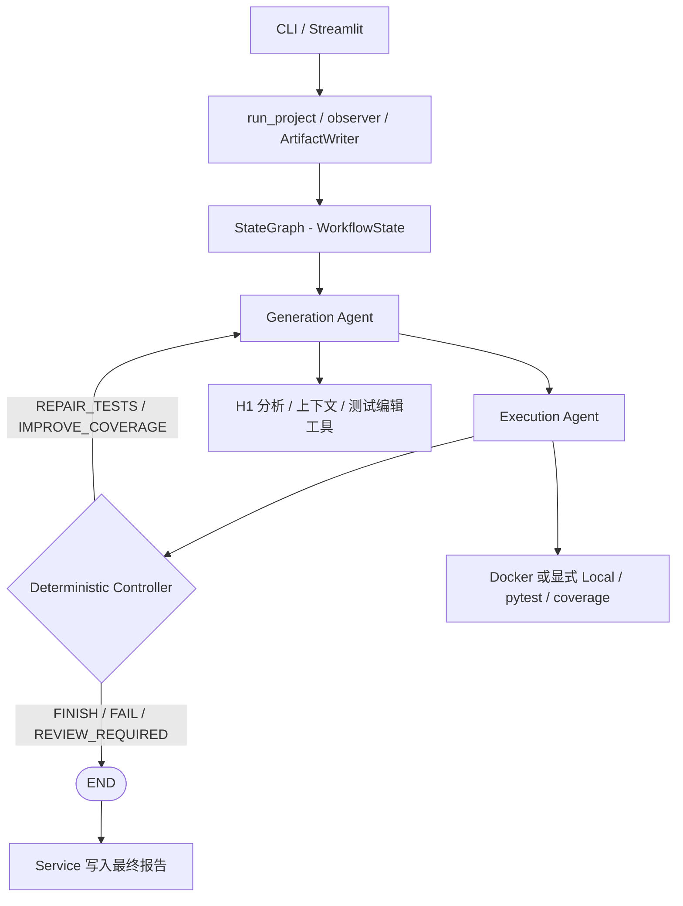

# TestPilot-WF V1.2 设计说明

## 1. 总体架构与复用边界

H2 在 H1 工具层之上增加双 Agent 协作与 LangGraph 编排。Generation 与 Execution 是两个正式业务 Agent；Controller 是确定性策略函数，报告生成是 Service 的收尾逻辑，均不调用额外 LLM。



核心实现：[agents.py](testpilot_wf/agents.py)、[llm.py](testpilot_wf/llm.py)、[service.py](testpilot_wf/service.py)、[workflow.py](testpilot_wf/workflow.py)。Generation 复用 H1 `AgentNodes` 的 analyze、plan、generate、repair、improve_coverage 方法，不运行 H1 的 graph、Controller 或 execute。Execution 使用既有 Runner 与 CoverageAnalyzer。H1 客户端提供可覆盖的角色 Prompt，H2 适配器分别设置独立角色约束。

## 2. 两个 Agent 的职责

| 角色 | 任务与工具 | 允许更新的业务状态 | 不承担的职责 |
|---|---|---|---|
| Generation | `INITIAL_GENERATION`、`REPAIR_TESTS`、`IMPROVE_COVERAGE`；扫描、AST、上下文、精确 Patch、候选校验 | 项目分析、目标模块、计划、测试、生成结果、版本、digest、消息和 warnings | 没有 Runner，不执行 pytest，不自行决定跨 Agent 路由 |
| Execution | `PREFLIGHT` → `EXECUTE` → `DIAGNOSE`；验证已提交测试、真实执行、覆盖率分析、独立诊断 | `execution_result`、`coverage`、`feedback`、`messages` | 不编辑测试或被测源码，不修改预算或版本 |
| Controller | 校验事实、诊断一致性与剩余预算 | 模式、计数、route、workflow_status、reason | 不调用 LLM，不修改测试 |

两个角色分别创建 GenerationLLM、ExecutionLLM，使用不同 system/task Prompt 和结构化输出 Schema。它们可以调用同一模型服务，独立性体现为职责、客户端和上下文约束，不表示不同模型权重。LLM 只返回结构化数据，可信 Python Agent 代码才拥有受控工具调用能力。

Execution 复用 H1 `ContextSelector` 的 `IMPROVE_COVERAGE` 证据选择分支，以取得 `existing_tests`、`execution` 和 `coverage`；发送给 Execution LLM 前将 `action` 明确设为 **`DIAGNOSE`**，并补充 test_version、test_plan、evidence_refs、environment_error、coverage_policy。既有字符预算和输出校验继续生效，源码见 [agents.py](testpilot_wf/agents.py)，对应测试见 [test_execution_context.py](tests/wf/test_execution_context.py)。

## 3. 结构化协议与共享状态

协议定义见 [schemas.py](testpilot_wf/schemas.py)。Pydantic 消息与诊断契约禁止多余字段，并校验诊断分类、建议动作、复核标志和消息方向；共享状态的写入边界另由 Service wrapper 检查。

| 协议 | 关键字段与约束 |
|---|---|
| `Diagnosis` | failure_category、diagnosis、suggested_action、evidence_refs、review_required、uncertainty；分类与动作须一致，源码缺陷/不确定性分类须要求复核 |
| `ExecutionFeedback` | 继承 Diagnosis；增加 test_version、execution_ref、coverage_ref、diagnosis_status |
| `GenerationResult` | mode、test_version、test_plan、tests_ref、digest、summary、warnings |
| `AgentMessage` | 唯一 message_id、连续 sequence、sender、receiver、message_type、test_version、payload、evidence_refs；envelope 与 payload 版本必须一致 |
| `WorkflowState` | 继承 H1 AgentState，增加 mode、test_version、test_digest、generation、feedback、messages、workflow_status、route、trace、extensions 等 |

正式消息只有两个方向：

```text
Generation -> Execution : generation_result / GenerationResult
Execution  -> Generation: execution_feedback / ExecutionFeedback
```

Controller 决策属于 Trace，不是 AgentMessage；扩展节点也不能新增正式消息发送者。Service 每次合并更新后重新验证状态，并检查消息序号和 ID 唯一性。

诊断分类包括 PASS、REPAIR_TEST、IMPROVE_COVERAGE、SUSPECTED_SOURCE_BUG、ENVIRONMENT_ERROR、REVIEW_REQUIRED、DIAGNOSIS_ERROR。模型只产生 Diagnosis，可信代码绑定版本和执行/覆盖率引用，且拒绝诊断引用当轮白名单之外的证据。工具事实在模型调用前落盘，即使诊断失败也保留。

H2 的控制依据是 `workflow_status`、`mode`、反馈及实际事实，不是继承自 H1 的 `status/history`。`state.json` 是精简观察快照，不是可恢复 checkpoint。

## 4. 测试版本与候选提交

首次合法测试集提交为 v1；每次合法修复或补测提交后递增一次。`digest()` 对按路径、内容组成的测试集合计算 SHA-256。Generation 拒绝没有实际变化的候选；Execution 验证最新 GenerationResult、消息、版本和实际 digest；Controller 再核验反馈版本、最新正式消息和测试 digest。

候选提交前执行 preflight、测试保留和已有断言保护。实现见 [validation.py](testpilot_wf/validation.py)：禁止 skip/xfail、部分进程/网络导入与动态执行；比较已有 assert 和 pytest.raises 的 AST，拒绝删除或修改。修复尽量使用 H1 的精确 old/new Patch，补测保留已有测试。不会通过修改生产源码、弱化期望值或跳过测试强行通过。

Generation 本地自修正只覆盖明确来自 H2 `preflight()` 的候选内容错误，最多额外尝试一次：

1. 初始分析与规划后保存合法基线，每轮复制基线生成候选。
2. 保留拒绝候选及脱敏错误，通过独立 `validation_feedback` 提供给第二轮。
3. 真实 `execution_agent_feedback` 继续保留，不用本地反馈伪造 pytest 事实。
4. 第二轮仍执行完整验证；只有最终接受才提交一个版本及一条正式消息。
5. 两轮失败安全终止；源码分析、API、状态、无变化、断言保护和 H1 内部校验错误不进入这层重试。

该预算独立于 Controller 的 Repair/Coverage 计数。两轮候选不等于两次 API 请求：多模块任务及既有 API/格式重试可能包含多次调用。对应代码与测试：[GenerationAgent](testpilot_wf/agents.py)、[test_generation_preflight.py](tests/wf/test_generation_preflight.py)。

## 5. 确定性 Controller 与反馈循环

[controller.py](testpilot_wf/controller.py) 的决策基于实际状态，模型不能直接设置最终 route。

| 条件 | 路由或终态 |
|---|---|
| 节点错误、反馈缺失/过期、digest 或最新消息不匹配、诊断失败 | FAIL |
| 疑似源码缺陷、证据不足或显式要求人工复核 | REVIEW_REQUIRED |
| 环境异常、超时、特定 Runner/收集失败、无实际通过或收集记录 | FAIL |
| pytest 失败，诊断明确为测试缺陷，有 traceback 且 Repair 预算允许 | 计数加一，`REPAIR_TESTS`，回 Generation |
| pytest 失败但诊断与事实冲突 | REVIEW_REQUIRED |
| pytest 通过但所需覆盖率缺失 | FAIL |
| 覆盖率不足，诊断为 PASS/IMPROVE_COVERAGE 且预算允许 | 计数加一，`IMPROVE_COVERAGE`，回 Generation |
| 对应预算耗尽 | FAIL |
| 实际通过/收集、退出码、错误数、覆盖率与 PASS 诊断一致 | FINISH |

默认 Repair 和 Coverage Improvement 各最多 2 轮，配置允许各 0–10 轮。每次反馈循环重新执行完整配置链，对新版本运行整个生成测试集。模型 PASS 但覆盖率不足仍会补测；源码疑点不会被自动当作测试错误修复。

保存的 [Demo Trace](docs/evidence/edge_cases-demo-docker-20261024-211020-dba414d0/trace.json) 展示：

```text
Generation(v1) -> Execution(REPAIR_TEST)       -> Controller(REPAIR_TESTS)
Generation(v2) -> Execution(IMPROVE_COVERAGE)  -> Controller(IMPROVE_COVERAGE)
Generation(v3) -> Execution(PASS)              -> Controller(FINISH)
```

这条证据的 LLM 响应是固定脚本，三轮 pytest/coverage 是真实 Docker 执行；四组真实模型实验均在 v1 完成，不能将两类结论混用。

## 6. Registry、Builder 与前后置扩展

`AgentProtocol` 约定 `name`、`writes`、`invoke(state) -> dict`。AgentRegistry 支持注册、查询与显式 `replace=True` 替换；`run_project(extra_agents=...)` 的额外注册默认不替换同名 Agent。空白、非字符串、保留名和含 `:` / `|` 的名称会被拒绝。

WorkflowBuilder 接受受控顺序链，要求：

- Generation 是首节点，Execution 必须存在；节点名称全部唯一，因此二者均只出现一次。
- 所有 Agent 已注册；Controller、START、END 不能混入普通 Agent 链。
- Execution 可以位于链中间；链尾固定连接独立 Controller。
- 任一非末节点发生错误时直接到 Controller，跳过余下节点；末节点错误也交由 Controller 终止。
- 修复/补测只返回 Generation，重新按链执行，不提供任意条件边或并行拓扑。

```text
默认：   Generation -> Execution -> Controller
前置：   Generation -> Audit -> Execution -> Controller
后置：   Generation -> Execution -> Audit -> Controller
组合：   Generation -> Before -> Execution -> After -> Controller
```

下面是使用已有接口的最小扩展示例，不增加正式 LLM Agent。可在项目根目录启动 Python 后执行；`AppConfig()` 使用内置默认值，实际实验配置见各运行报告。

```python
from testpilot.config import AppConfig
from testpilot_wf.service import run_project


class MockAuditAgent:
    writes = {"extensions"}

    def __init__(self, name="audit"):
        self.name = name

    def invoke(self, state):
        observation = {
            "seen_version": state.test_version,
            "seen_digest": state.test_digest,
            "has_feedback": state.feedback is not None,
        }
        return {"extensions": {**state.extensions, self.name: observation}}


state = run_project(
    "examples/basic",
    config=AppConfig(),
    demo=True,
    extra_agents=[MockAuditAgent()],
    chain=("generation", "execution", "audit"),
)
```

前置时改为 `chain=("generation", "audit", "execution")`。组合链需分别注册 `MockAuditAgent("before")` 和 `MockAuditAgent("after")`。前置节点在首轮尚无反馈，在后续轮次可能读到上一版本反馈；后置节点能观察当轮 ExecutionFeedback，扩展逻辑应核对版本，不能把“存在反馈”直接当作“反馈属于当前版本”。

## 7. 扩展状态隔离、预算与异常

Service wrapper 向节点传入深拷贝，只合并 `invoke()` 返回的更新，并依次校验声明的 `writes` 与扩展专用限制：普通扩展**只能返回 `extensions`**，即使自己声明拥有其他字段也不能越权。因此不能修改 generated_tests、test_version、test_digest、messages、feedback、execution_result、coverage、repair_count、coverage_round、route、workflow_status。

后置扩展不会覆盖正式 ExecutionFeedback 或追加 AgentMessage，Controller 仍读取 Execution 的最新消息并执行原有版本、digest、pytest/coverage 和预算校验。扩展执行记录进入 Trace，任务标记为 `EXTENSION`。

`extensions` 是可自由组织的字典；按 Agent 名分子键是约定，不是强制的子键权限系统。返回值会替换整个字段，扩展示例显式合并既有数据。节点可读取状态副本；写权限隔离不等于隐藏状态或对 Python 插件实施安全沙箱。

节点异常或权限错误由 wrapper 回滚本次更新、记录 error/failure_stage，再经 Controller 安全终止。非法注册会在装配阶段被拒绝；图构建/运行异常由 Service 的外层错误边界记录 FAIL。图递归上限为：

```text
(len(chain) + 1) * (1 + max_repair_rounds + max_improvement_rounds) + 5
```

该上限随链长度与预算调整；扩展节点本身不消耗 Repair/Coverage 次数，也不能改写计数。扩展验证代码见 [test_workflow.py](tests/wf/test_workflow.py)，现存 [24 项通过日志](docs/evidence/extensibility/mock_agent_tests.txt) 支持前置、后置、组合链、反馈保留、预算、越权及异常路径。

## 8. 观察、证据与报告时序

Service 的 observer 发布节点开始/完成与 Controller 决策，Execution 的 progress 发布临时 PREFLIGHT、EXECUTE、DIAGNOSE 快照。内部阶段通知不新增正式 Trace 事件。

- [CLI](testpilot_wf/cli.py) 以阶段、Trace 长度、版本和轮次去重状态，以消息 ID 去重通信，以 Trace step 去重决策；使用 `flush=True` 实时输出。Generation 只展示真实任务模式，不虚构内部阶段。
- [Streamlit](testpilot_wf/ui.py) / [只读投影](testpilot_wf/ui_state.py) 展示 Workflow、状态、Timeline 和通信；会重新读取最终产物，并在新运行时清空旧状态。Report 是 UI 产物节点，不是第三个 Agent。
- Controller 终止后，Service 才写最终 JSON、相关产物与 Markdown，并再次发布状态。CLI 在 `run_project()` 返回后校验报告可读性、状态及版本匹配；报告错误按 CLI 错误处理，不改底层 WorkflowState。

每版本保存测试、执行、覆盖率、反馈；顶层保存消息、Trace、模型调用、最终报告与精简状态。ArtifactWriter 脱敏已知环境敏感值；不会把完整 Prompt 写入常规 CLI 输出。日志引用及验证口径见 [Validation](docs/Validation.md)。

## 9. 架构取舍与限制

- 复用 H1 状态与工具可减少重复实现，但 H1/H2 状态字段并存，需明确 H2 的权威控制字段。
- 确定性 Controller 约束模型建议，仍不能证明模型诊断、测试期望或源码契约正确；不确定性必须留给人工检查。
- AST 保留与 preflight 是保守启发式，helper、fixture、参数等变化仍可能影响语义；高覆盖率不是正确性证明。
- 只运行新生成测试，不自动运行被测项目原套件；默认不安装项目依赖，复杂项目需准备兼容执行环境。
- Local 无宿主隔离，Docker 也不是生产级多租户沙箱；扩展 Python Agent 应被信任。环境失败不自动回退 Local。
- 当前扩展点是有界顺序链，不支持任意 DAG、自由多 Agent 对话、并行或热插拔；保存快照不支持断点续跑。
- 原生 Streamlit 数据单元格已居中，表头独立居中未实现；不通过高风险内部 DOM/Canvas 修改伪装成功。

本轮文档整理只核对源码与现存证据，不修改实现，也不把已删除的历史日志当作当前验收结果。
