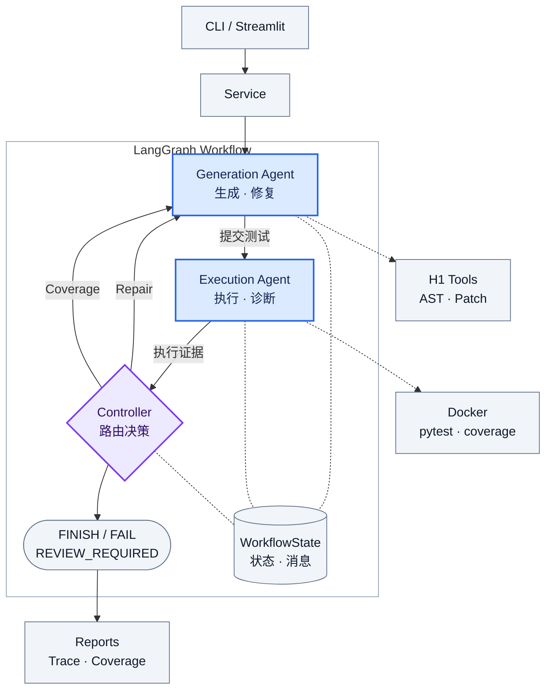

# TestPilot-WF

《软件工程与项目实践》Homework 2：基于 LangGraph 的双 Agent 自动化测试工作流。Generation Agent 负责测试设计与编辑，Execution Agent 负责真实执行和独立诊断，确定性 Controller 根据执行事实、反馈和预算决定继续修复、补测或终止。

本项目复用 `testpilot/` 中 Homework 1 的扫描、AST 分析、上下文选择、测试校验、Runner 和报告工具；H2 的入口与编排位于 `testpilot_wf/`。Controller 不调用 LLM，不是第三个业务 Agent。

- [系统设计](Design.md)：职责、协议、路由和受控扩展。
- [实验与验证](docs/Validation.md)：四组 Real DeepSeek + Docker、一组 Demo + Docker、MockAgent 24 项测试日志。
- [运行与演示](docs/Demo.md) · [约一分钟演示视频](Sample_Video.mp4)。

## 核心功能与架构



实线为执行顺序与条件路由，虚线为共享状态关联或工具依赖，不代表额外路由。正式消息为 Generation → Execution 的 `generation_result` 与 Execution → Generation 的 `execution_feedback`；Controller 读取 WorkflowState，不是消息接收 Agent。图中 Repair 对应 `REPAIR_TESTS`，Coverage 对应 `IMPROVE_COVERAGE`，两条路径使用独立预算；Reports 是 Service 的收尾产物。图示默认 Docker 路径，可信代码可显式选择 Local。

- **独立职责**：两个角色使用独立客户端与不同 Prompt、结构化输出约束；可以使用同一 DeepSeek 模型服务，不共享角色对话。
- **真实执行**：Execution 按 PREFLIGHT → EXECUTE → DIAGNOSE 工作，pytest/coverage 事实先保存，再提供给诊断模型。模型的 PASS 不能覆盖客观失败。
- **有界反馈**：测试缺陷进入 Repair，覆盖不足进入 Coverage Improvement；两类预算分别控制，默认各最多 2 轮。
- **版本与保护**：候选完整验证通过且内容确有变化才递增版本；保留原有测试和断言。Generation 的本地 preflight 内容错误最多额外尝试一次，不消耗跨 Agent 预算。
- **受控扩展**：AgentProtocol、AgentRegistry、WorkflowBuilder 支持在 Execution 前后插入已注册扩展节点；普通扩展仅能更新 `extensions`。
- **可观察性**：CLI 实时显示状态、阶段、消息和决策；Streamlit 展示 Workflow、Current Status、Execution Timeline、Agent Communication 及报告下载。

## 环境安装与配置

需要 Python **3.11+**，以下使用 Conda 创建 Python **3.13** 环境。Docker 执行需要 Docker Desktop 或兼容 Docker Engine，并使用 Linux 容器：

```powershell
conda create -n testpilot-wf python=3.13 -y
conda activate testpilot-wf
python -m pip install -e ".[web,dev]"
docker build -t testpilot-runner:latest .
```

镜像定义见 [Dockerfile](Dockerfile)，内置 pytest 和 pytest-cov。项目配置见 [config.yaml](config.yaml)，校验规则见 [config.py](testpilot/config.py)。当前仓库配置为：

| 配置 | 当前值 |
| :---: | :---: |
| 模型 | `deepseek-flash` |
| 单次输出上限 / 上下文字符预算 | 50000 tokens / 100000 characters |
| 行 / 分支覆盖率阈值 | 80% / 70% |
| Repair / Coverage Improvement 上限 | 各 2 轮 |
| 执行后端 / 超时 | Docker / 30 秒 |
| 自动安装项目依赖 / 自动 Local 回退 | 均关闭 |

配置加载规则：先使用显式 `--config` 指定的文件；未指定时读取启动目录的 `config.yaml`；文件不存在才使用内置默认值。CLI 中明确指定的选项覆盖所加载配置。显式配置文件不会再与根目录配置叠加。H2 服务始终禁用自动 Local 回退。

## Real DeepSeek 与 Demo

| 模式 | Generation / Execution 的模型响应 | pytest / coverage | API Key |
| :---: | :---: | :---: | :---: |
| Real：不带 `--demo` | 两个独立角色实际调用 DeepSeek | 真实执行 | 需要 |
| Demo：带 `--demo` | 内置固定响应，不调用 LLM | 真实执行 | 不需要 |

真实模式优先读取进程环境变量 `DEEPSEEK_API_KEY`，否则读取**启动目录** `.env` 中同名字段。参考 [.env.example](.env.example)，只在本地填写有效密钥；`.env` 已在 [.gitignore](.gitignore) 中排除。

```powershell
# 离线模型响应 + Docker 真实执行，演示修复和补测
python -m testpilot_wf examples/edge_cases --demo --runner docker

# 已配置有效 Key 后：真实双 Agent + Docker
python -m testpilot_wf examples/basic --runner docker

# 指定目标模块、阈值及预算
python -m testpilot_wf examples/multi_module --target order.py --runner docker --line-threshold 85 --branch-threshold 75 --max-repair 2 --max-improvement 2

# 仅对可信输入显式使用 Local
python -m testpilot_wf examples/basic --demo --runner local
```

`testpilot-wf` 是安装后的等价入口；保留的 `testpilot` 是 H1 兼容入口。CLI 默认实时输出实际阶段和正式通信，支持 `--quiet` 只保留最终结果；还支持 `--config`、`--output`、`--no-coverage`。`FINISH`、`FAIL`、`REVIEW_REQUIRED` 分别返回 0、1、2；配置或报告产物错误返回 1。`[Report] FINALIZED` 仅在返回后核验报告成功才输出，不等于 Workflow 一定成功。

## Streamlit

```powershell
python -m streamlit run testpilot_wf/ui.py
```

打开终端提示的本地地址。侧栏选择 Demo 或真实模式、执行后端、目标模块、覆盖率阈值及预算，再选择项目并运行。默认勾选 Demo；真实模式须取消勾选并配置 Key。Local 需要明确确认输入代码可信。

界面通过 Workflow、Current Status、Execution Timeline 和 Agent Communication 实时展示执行阶段、消息交付及条件路由，并提供历史证据与报告下载。Report 是 Service 报告产物的展示节点，不是额外 Agent；最终产物生成后才确认完成，重新运行会重置旧状态。实现见 [ui.py](testpilot_wf/ui.py) 和 [ui_state.py](testpilot_wf/ui_state.py)。

## 实验结果概览

以下为仓库现存报告中的**最终生成测试集**结果，不是模型生成成功率，也不代表源码无缺陷。通过率按 `passed / collected_test_cases` 计算，覆盖率按选定目标模块汇总。详细索引、调用记录与统计口径见 [Validation](docs/Validation.md)。

| 模式 / 项目 | Workflow | 通过 / 收集 | 通过率 | 行 / 分支覆盖率 | 最终版本；修复 / 补测 |
| :---: | :---: | :---: | :---: | :---: | :---: |
| Real / basic | FINISH | 14 / 14 | 100% | 100% / 100% | v1；0 / 0 |
| Real / advanced_project | FINISH | 127 / 127 | 100% | 99.19% / 100% | v1；0 / 0 |
| Real / edge_cases | FINISH | 19 / 19 | 100% | 100% / 100% | v1；0 / 0 |
| Real / multi_module | FINISH | 48 / 48 | 100% | 100% / 100% | v1；0 / 0 |
| Demo / edge_cases | FINISH | 9 / 9 | 100% | 100% / 100% | v3；1 / 1 |

四组 Real 记录均包含 Generation 与 Execution 的 completed 调用；Demo 的 `llm_calls.json` 为空。真实实验均在 v1 完成，不能据此声称它们演示了真实 LLM 修复循环；循环路径由单独的 Demo 证据与 Mock 测试支撑。

## 测试命令

```powershell
python -m pytest
python -m pytest tests/wf -q
python -m pytest tests/wf/test_cli.py tests/wf/test_ui_wf.py tests/wf/test_ui_state.py -q
python -m pytest tests/wf/test_workflow.py -k "mock_agent or registry or extension" -v
python -m ruff check .
python -m ruff format --check .
```

现存 [MockAgent 原始日志](docs/evidence/extensibility/mock_agent_tests.txt) 记录 **24 passed，36 deselected**；这不是全仓库测试总数。最新全量回归为 **434 passed、3 skipped**；Workflow 专项 **149 passed**，Ruff lint 与 format check 均通过。UI 历史记录测试已改用稳定的仓库内 fixture，保留全部原有断言，解除对可清理实验目录的依赖。修复说明、跳过原因和完整日志见 [最终检查](docs/Validation.md#5-最终回归与验证入口)。本轮未调用付费 API。

普通测试默认禁止外网并禁用 `.env` 加载。真实集成测试需要事先在当前进程安全设置有效 `DEEPSEEK_API_KEY`，且显式启用付费测试：

```powershell
$env:TESTPILOT_RUN_INTEGRATION = "1"
python -m pytest tests/integration/test_wf_deepseek.py -v
Remove-Item Env:TESTPILOT_RUN_INTEGRATION
```

## 目录与证据

| 路径 | 内容 |
| :---: | :---: |
| [testpilot/](testpilot/) | H1 复用工具、Runner、Schema 和兼容入口 |
| [testpilot_wf/](testpilot_wf/) | H2 Agent、协议、Controller、Builder、Service、CLI 和 UI |
| [tests/wf/](tests/wf/) | H2 协作、路由、扩展、候选恢复、CLI 和 UI 测试 |
| [examples/](examples/) | 四组内置被测项目 |
| [docs/evidence/](docs/evidence/) | 五组保存的运行证据和扩展测试日志 |
| [Sample_Video.mp4](Sample_Video.mp4) | 约 59.21 秒的演示视频；播放核对说明见 Demo 文档 |

新运行保存到 `runs/<项目>-<模式>-<后端>-<时间>-<ID>/`，该目录被 Git 忽略。主要产物包括 `versions/<版本>/` 下的测试、执行、覆盖率和反馈，及顶层 `messages.json`、`trace.json`、`llm_calls.json`、`test_plan.json`、`generated_tests/`、`final_report.json`、`final_report.md`。候选拒绝与局部恢复证据另存于 `rejected/`、`repairs/`、`generation_attempts/`；`state.json` 仅用于观察，不支持断点续跑。证据收集脚本为 [collect_wf_evidence.py](scripts/collect_wf_evidence.py)。

## 作业评分项对应

依据 Homework 2 官方 PPT 的四个评分维度，项目选择“代码 → 生成测试 → 执行”方向。基本顺序流程为必需项；条件分支、反馈循环、状态追踪与错误恢复为已实现的推荐项，不包含并行执行。

| 评分项 | 代码与验证依据 |
| :---: | :---: |
| 流程完整性 40% | [Workflow](testpilot_wf/workflow.py) · [Controller](testpilot_wf/controller.py) · [Demo 三轮验证](docs/Validation.md#3-demo--docker-反馈循环) |
| Agent 协作 30% | [Agents](testpilot_wf/agents.py) · [消息与状态协议](testpilot_wf/schemas.py) · [Real 调用验证](docs/Validation.md#21-两个角色的实际调用记录) |
| 可扩展性 20% | [扩展接口与编排](testpilot_wf/workflow.py) · [扩展测试](tests/wf/test_workflow.py) · [专项日志：24 passed](docs/evidence/extensibility/mock_agent_tests.txt) |
| 文档 10% | [Design](Design.md) · [Validation](docs/Validation.md) · [Demo 与视频说明](docs/Demo.md#5-一分钟视频与讲解建议) |
