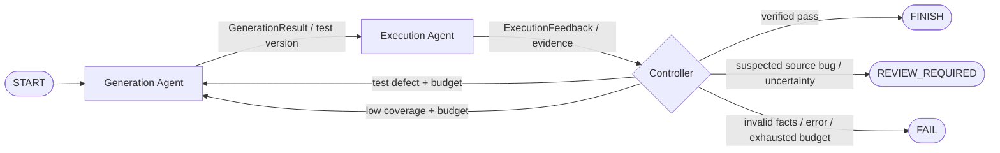

# TestPilot-WF

《软件工程与项目实践》Homework 2：**代码 → Test Generation Agent → Test Execution Agent**。
两个独立角色分别负责测试创作与执行诊断，LangGraph 组织消息传递和有界反馈循环，确定性 Controller 校验 pytest 与 coverage 的客观结果。

复用作者本人 [Homework 1 TestPilot](https://github.com/ycwang-April/SE1-TestPilot) 的底层能力；H1 原目录未修改。[源码审计与复用分析](docs/H1-Audit.md)、[设计文档](Design.md)、[实际验收结果](docs/Validation.md)。

## 快速运行

Python 3.11+。本机已有 `D:\conda_envs\testpilot\python.exe` 可直接运行；激活对应环境后使用以下命令。新环境可安装：

```powershell
python -m pip install -e ".[web,dev]"
```

在仓库根目录运行 Docker Desktop（Linux 容器），首次构建镜像：

```powershell
docker build -t testpilot-runner:latest .
python -m testpilot_wf examples/edge_cases --demo --runner docker
python -m streamlit run testpilot_wf/ui.py
```

界面采用左侧 Workflow 图、右侧 Current Status，下方直接展示 Execution Timeline、Agent Communication 和 Results & Artifacts。节点按真实 Trace / observer 显示待执行、运行、完成、失败或待检查；只有最终 JSON 与 Markdown 报告均存在后，Report 才显示终态。完成后重绘从保存产物恢复，开始新运行时清除上一轮状态。

Timeline 保留每轮修复/补测和 Controller 路由，实时内部阶段明确标注为 observer 通知；通信面板按真实消息顺序显示方向、版本、任务与诊断摘要。原始 JSON、诊断长文本和证据默认折叠，报告、Trace、消息、计划和测试 ZIP 下载继续保留。[本次 UI 验收与截图](docs/UI-Validation.md)。

界面采用左侧 Workflow 图、右侧 Current Status，下方直接展示 Execution Timeline、Agent Communication 和 Results & Artifacts。节点按真实 Trace / observer 显示待执行、运行、完成、失败或待检查；只有最终 JSON 与 Markdown 报告均存在后，Report 才显示终态。完成后重绘从保存产物恢复，开始新运行时清除上一轮状态。

Timeline 保留每轮修复/补测和 Controller 路由，实时内部阶段明确标注为 observer 通知；通信面板按真实消息顺序显示方向、版本、任务与诊断摘要。原始 JSON、诊断长文本和证据默认折叠，报告、Trace、消息、计划和测试 ZIP 下载继续保留。[本次 UI 验收与截图](docs/UI-Validation.md)。

`edge_cases` Demo 稳定展示：导入错误 → Execution 反馈 → Generation 修复导入 → pytest 通过但覆盖不足 → 补测 → 9 个用例通过、行/分支覆盖率 100%。**Demo 的两个模型响应均为固定脚本，pytest 与 coverage 确实运行，不能把它当作真实 DeepSeek 推理证据。**

Docker 不可用时安全失败，绝不自动回退 Local。仅对可信代码显式选择：

```powershell
python -m testpilot_wf examples/basic --demo --runner local
```

## 真实 DeepSeek 模式

在本项目根目录创建 `.env`（参考 `.env.example`），填入有效的 `DEEPSEEK_API_KEY`。该文件被 Git 忽略。输入源码、测试和执行证据会发送给 DeepSeek，产生 API 费用。用户已告知 H1 原 API 被删除，本次交付**未完成真实 DeepSeek 验证**。

```powershell
python -m testpilot_wf examples/basic --runner docker
```

Generation 与 Execution 使用不同 system/task prompt、独立模型适配器实例和结构化 schema。检查运行目录 `llm_calls.json` 的 `agent`、`task`、`status`，确认两个角色均有 `completed` 调用。若缺 Key/API 错误，保留失败报告，不伪造成功。

## 配置与入口

`python -m testpilot_wf` 或安装后的 `testpilot-wf` 是 H2 CLI。保留的 `testpilot` 入口及 `testpilot/ui/streamlit_app.py` 属于 H1 回归兼容路径，不是 H2 演示入口。

```powershell
python -m testpilot_wf examples/multi_module --target order.py --runner docker --line-threshold 85 --branch-threshold 75 --max-repair 2 --max-improvement 2
python -m testpilot_wf examples/edge_cases --demo --runner docker --max-repair 0
```

配置优先级：CLI 参数 > 显式 `--config` > 根目录 `config.yaml` > 默认值。支持目标模块、Runner、覆盖率阈值、修复/补测预算、`--no-coverage`、输出目录。两种反馈默认各最多 2 轮。H2 始终关闭自动 Local fallback。

CLI 退出码：0 = FINISH，1 = FAIL，2 = REVIEW_REQUIRED。疑似生产代码缺陷或证据不足会停止自动修复；不会修改被测源码，也不会通过删除测试、改断言或跳过测试强行通过。

## 工作流



Execution 包括 Preflight → 真实 pytest/coverage → 独立 LLM Diagnose；正常通过也有独立质量观察。LLM 的 PASS 不能覆盖非零退出、失败、零通过、未收集或不达标覆盖率。

## 项目结构

| 路径 | 职责 |
|---|---|
| `testpilot/` | H1 工具、Runner、Schema、精确 Patch、报告与兼容代码 |
| `testpilot_wf/agents.py`, `llm.py` | 两个角色、独立推理、工具权限和反馈适配 |
| `testpilot_wf/schemas.py` | 消息、版本、诊断与共享状态 |
| `testpilot_wf/controller.py`, `workflow.py` | 确定性策略、Protocol/Registry/Builder、LangGraph |
| `testpilot_wf/service.py`, `cli.py`, `ui.py` | 运行服务、Trace、CLI、实时 Streamlit |
| `tests/unit/`, `tests/wf/`, `tests/integration/` | H1 回归、H2 单元/端到端/扩展/UI、显式真实集成 |
| `examples/` | basic、edge_cases、multi_module、advanced_project |
| `docs/evidence/` | 本次实际执行的精选证据，不含 H1 旧运行报告 |

## 验收与复现

```powershell
python -m pytest
python -m ruff check .
python -m ruff format --check .
```

仅运行 H2 的真实 Docker 集成测试（先在当前终端配置有效 Key，默认跳过）：

```powershell
$env:TESTPILOT_RUN_INTEGRATION = "1"
python -m pytest tests/integration/test_wf_deepseek.py -v
Remove-Item Env:TESTPILOT_RUN_INTEGRATION
```

所有普通测试禁用外网和 `.env` 加载。扩展测试实际在两个业务 Agent 间注册并插入 MockAgent，验证调用、状态传递及原 Agent 无须修改。MockAgent 不是第三个业务 LLM Agent。

## 运行证据

每次运行在 `runs/<项目>-<模式>-<后端>-<时间>-<ID>/` 保存：

- `versions/001/tests.json`, `execution.json`, `coverage.json`, `feedback.json`：按版本的真实证据。
- `messages.json`, `trace.json`, `llm_calls.json`：消息、决策与分角色模型调用。
- `repairs/`, `rejected/`：局部修复尝试和被拒绝候选。
- `generation_attempts/`：Generation 本地预检查自修正的接受记录及隔离的第二轮修复证据。
- `generated_tests/`, `test_plan.json`, `final_report.json`, `final_report.md`：最终可审查输出。
- `state.json`：精简观察快照，**不支持断点续跑**。

`runs/` 不提交；可用 `python scripts/collect_wf_evidence.py <run目录>` 收集脱敏后的精选证据。已有测试文件不覆盖、不混入本次执行；新测试在临时副本运行。

Generation 候选若因 H2 `preflight()` 的语法、禁止导入或标记等内容规则失败，最多额外生成一次。第二次上下文包含结构化 `validation_feedback`；每次从同一合法状态副本开始，成功才提交一个版本，不额外发送消息或消耗 Repair/Coverage 预算。API、分析、状态、断言保护、无实际变化等错误不触发此重试；H1 内部校验及其已有重试保持原行为，不再叠加本地重试。

## 评分项对应

| 维度 | 对应实现与验收 |
|---|---|
| 流程完整性 40% | 可执行 LangGraph，正常/修复/补测/失败路径，Local 和 Docker 真实 pytest |
| Agent 协作 30% | 两个独立 prompt/LLM schema、双向结构化消息、版本和摘要校验、共享状态权限 |
| 可扩展性 20% | AgentProtocol、Registry 替换、Builder 受控链，MockAgent 插入实测 |
| 文档 10% | README、Design、审计、验收证据、运行命令、演示脚本 |

一分钟演示建议见 [docs/Demo.md](docs/Demo.md)。可选视频未录制。不执行 Git 提交或 push；由用户自行创建独立仓库和提交作业。
