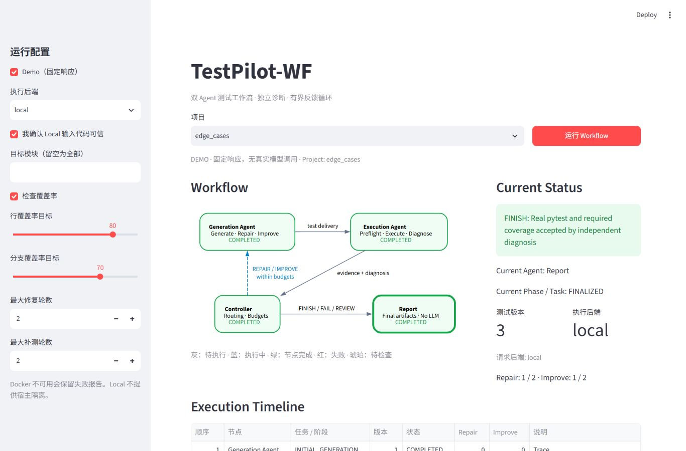
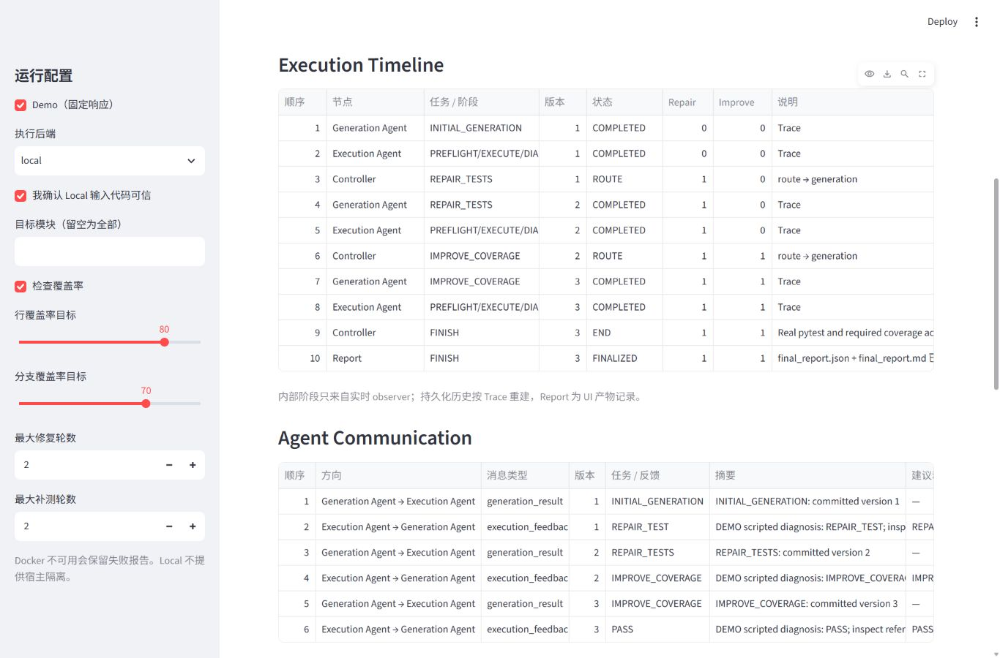

# Streamlit UI 与 Workflow 状态可视化验收

日期：2026-10-23。此次仅优化展示层，修改 `testpilot_wf/ui.py`、新增只读 `ui_state.py`，扩展 UI 测试及说明文档。未修改 service、业务 Agent、Controller、Schema、Registry/Builder、Runner 或覆盖率逻辑。

## 页面与状态规则

- 顶部保留项目、模式、运行入口和侧边栏配置；核心区左图右状态。
- 当前状态显示 Agent、真实阶段或 Generation 任务模式、版本、实际/请求后端及两类预算。
- Workflow 图采用圆角、分层字体与统一状态颜色。输入不拼入 DOT；只有固定节点名、状态和标签可进入图。
- 图中的 Report 表示产物。终态 JSON 可解析且 Markdown 报告已存在时，按 FINISH / FAIL / REVIEW_REQUIRED 使用绿/红/琥珀色强调。没有最终报告时保持 Report 待生成，不能把 Controller 的终态当作报告完成。
- Execution Timeline 从真实 Trace 重建，保留修复/补测顺序、预算和路由。瞬时 observer 阶段单独标注，Report 行明确为 UI 产物记录，不修改原始 Trace。
- Agent Communication 使用真实消息的 sequence、sender/receiver、版本和 payload 摘要；不会产生 Controller 消息。原始字段和证据仍可折叠查看。
- 运行完成后重绘保持原报告状态；重新开始清除旧运行和活跃状态。缺失指标显示 `—`，覆盖率显示百分号。报告/Trace/消息/计划/测试 ZIP 下载均保留。

## 实际验证

| 检查 | 结果 |
|---|---|
| UI 状态投影 + Streamlit AppTest | **26 passed** |
| 完整 pytest | **368 passed, 3 skipped**，101.81 秒 |
| Ruff lint | All checks passed |
| Ruff format check | 104 files already formatted |
| Docker Demo | FINISH，v3，9 passed，Repair=1、Improve=1，行/分支覆盖率 100% |
| 浏览器实测 | 1366×900；初始状态、Local Demo 完整循环、终态高亮、页面重绘、Timeline 与消息查看 |

自动化测试覆盖初始页面、Generation 激活、Execution 三个阶段、Controller 路由、尚无报告的终态、三种 Report 颜色、两种模式、失败/诊断原因、缺失指标、完整循环、页面重绘、第二次运行和新运行启动失败时清除旧结果。测试中的 Mock 产物明确为 UI fixture，不冒充真实模型运行。

原始日志：[pytest](evidence/ui-20261023/pytest.txt)、[Ruff lint](evidence/ui-20261023/ruff-check.txt)、[Ruff format](evidence/ui-20261023/ruff-format.txt)。

Docker 本次精选证据：[final_report.json](evidence/edge_cases-demo-docker-20261023-090355-32c9b9aa/final_report.json)。Demo 模型响应为固定脚本，pytest/coverage 为真实 Docker 执行。

还读取了本机 2026-10-23 保存的 basic、multi_module、edge_cases 三份真实 DeepSeek + Docker 报告，均为 FINISH 且 UI 的活跃节点为 Report；两角色已有 completed 调用可在原产物中核查。[只读兼容检查记录](evidence/ui-20261023/historical-artifacts.json)。这不代表本次重新执行了真实 API。

## 截图

以下为本次浏览器中实际运行的 Local Demo，固定模型响应，非 Mock 结果页。

完成态：Report 为加粗成功节点，Controller 不再是活跃节点。



同一次运行的时间线和双 Agent 消息：



## 验证范围与复现

三个 pytest skip 仍为两个需显式授权的真实 API 集成测试，以及 Windows 符号链接权限测试。本次未发起真实模型调用；FAIL/REVIEW_REQUIRED 的 UI 映射使用 Mock 产物和 AppTest 验证，未刻意制造真实生产源码缺陷。没有承诺手机端布局或新增持久化续跑能力。

```powershell
python -m streamlit run testpilot_wf/ui.py
python -m pytest tests/wf/test_ui_wf.py tests/wf/test_ui_state.py -q
python -m pytest -q
python -m ruff check .
python -m ruff format --check .
python -m testpilot_wf examples/edge_cases --demo --runner docker
```
